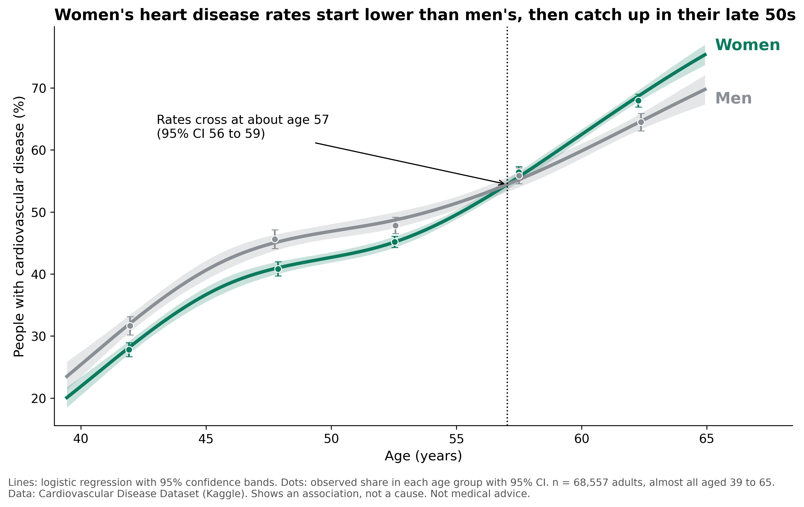

# Women's Heart Risk Starts Later, Then Climbs Faster

**In records from nearly 69,000 adults, women were less likely than men to have heart disease in their 40s but caught up by about age 57. High blood pressure stood out as the clearest warning sign at every age.**

By Masoumah Haidari, Aryana Hou, Sara Sultani, Patrick Verma · OpenBio 2026 Datathon, Track 2: Cardiovascular Health in Women

> This article describes a student data analysis. It is not medical advice, a diagnostic tool or clinical guidance.

**Figure 1. The share of people with cardiovascular disease at each age, for women (green) and men (grey). Lines come from a statistical model, and the shaded bands show its uncertainty (95% confidence intervals). Dots are the observed share in each age group. Women start lower, but their line climbs more steeply and crosses the men's at about age 57. (Source: our analysis of the Cardiovascular Disease Dataset, n = 68,557.)**

## Introduction

Cardiovascular disease (CVD), which includes conditions affecting the heart and blood vessels, is the leading cause of death among women worldwide (Rajendran et al., 2023). Although CVD affects both men and women, research suggests that some risk factors, like diabetes, smoking, and high blood pressure, may have a greater impact on women (Rajendran et al., 2023). Understanding these risk factors is important for identifying women who are at higher risk and improving cardiovascular disease prevention.

Previous studies have identified several factors associated with CVD, including high blood pressure, abnormal cholesterol levels, diabetes, obesity, smoking, and physical inactivity (Mehta et al., 2023). The American Heart Association also reported blood pressure, blood glucose, cholesterol, body mass index (BMI), smoking, and physical activity as important measures of cardiovascular health (Lloyd-Jones et al., 2022). Alcohol consumption can also affect cardiovascular health, although its relationship with CVD depends on other factors like drinking patterns and amounts consumed (Piano et al., 2025).

While all of these factors are identified for being associated with CVD, an important question remains: Which measured risk factors are most strongly associated with cardiovascular disease in women? To explore this question, we analyzed health data from 44,690 women, examining age, BMI, blood pressure, cholesterol, glucose, smoking, alcohol consumption, and physical activity. By comparing these factors, we aim to identify which factor has the strongest associations with CVD in our dataset and understand how different health characteristics relate to cardiovascular disease among women.

## The Data and Our Methods

Our main source is the [Cardiovascular Disease Dataset](https://www.kaggle.com/datasets/sulianova/cardiovascular-disease-dataset), 70,000 medical exam records with age, sex, height, weight, blood pressure, cholesterol and glucose levels, self-reported smoking, drinking and exercise, and whether the person has CVD. We removed 1,443 records (2%) with physically impossible values, such as a blood pressure of 11,000, and documented every rule in our [cleaning log](cleaning_log.md). We used **logistic regression**, a standard method for estimating how the chance of a yes-or-no outcome changes with each factor, and checked our main result nine different ways. Three limits were noted throughout. About half of the people in this dataset have CVD, far more than in the general population, and the source does not say where or how they were chosen, so percentages describe this group, not all adults. Every measurement was taken at a single visit, so we can see associations but not which came first. And the data cover ages 39 to 65 and record sex only as female or male. For the global picture we used published country-level tables from Li et al. (2025), based on Global Burden of Disease estimates. A third, computer-generated dataset was also provided; we tested it and found that no model could predict its outcome better than chance, so we did not use it.

## What We Found

### Women start lower, then catch up

In their early 40s, about 28% of women in the data had CVD, compared with about 32% of men. In the late 40s the gap was similar: 41% against 46%. Then it closed. In the 55 to 59 age group the two were level at about 56%, and among people aged 60 to 65, women were **more** likely than men to have CVD, at about 68% against 65%. Our model places the crossover at about age 57, and we are 95% confident it falls between 56 and 59 (Figure 1).

To put a number on how fast risk climbs, we use **odds**: the chance something is true divided by the chance it is not. An **odds ratio** compares two odds. An odds ratio of 1 means no difference; 1.5 means the odds are 50% higher. Each odds ratio comes with a **95% confidence interval**, the range of values consistent with the data. If that range does not include 1, the data rule out "no difference" with reasonable confidence.

For each additional decade of age, women's odds of having CVD rose by about 73% (odds ratio 1.73, 95% confidence interval 1.67 to 1.79), compared with about 54% for men (1.54, 1.48 to 1.61). These numbers already account for blood pressure, cholesterol, glucose, body mass index (BMI, a measure of weight relative to height), smoking, drinking and exercise. Put differently, women's odds climbed about 12% faster per decade than men's (95% confidence interval 6% to 18%).

**Each decade of age was linked to a 73% rise in women's odds of having heart disease, compared with 54% for men.**

### Blood pressure and cholesterol rise faster in women, too

Part of the story shows up in the risk factors themselves (Figure 2). From the early 40s to the early 60s, women's average systolic blood pressure (the top number in a reading) rose by about 12 points, compared with about 8 for men, so by their 60s women had nearly caught up. The share of women with high cholesterol rose by about 18 percentage points, against about 14 for men.

**Figure 2. Average systolic blood pressure (left) and the share with above-normal cholesterol (right) at each age, with 95% confidence intervals. Both rise faster in women than in men. (Source: our analysis of the Cardiovascular Disease Dataset.)**

Before accounting for any risk factors, women's odds rose about 21% faster per decade than men's. After accounting for them, the gap shrank to about 12%, but it did not disappear. Measured risk factors explain some of women's steeper climb, not all of it. We think menopause may be part of the reason. The American Heart Association identifies the years around the final menstrual period as a time when cardiovascular risk factors can accelerate (El Khoudary et al., 2020). In the Study of Women's Health Across the Nation, cholesterol levels rose most in late perimenopause and early postmenopause, even after accounting for age (Derby et al., 2009). Another study following the same cohort found that fat gain sped up and lean muscle declined around the transition, even though the rate of weight gain did not change (Greendale et al., 2019). A third found that arterial stiffness increased particularly rapidly near the final menstrual period (Samargandy et al., 2020). These changes offer a plausible explanation for some of the midlife pattern we see. But our records do not say who had reached menopause or measure hormones, so we cannot show that menopause caused our crossover at about 57. The AHA statement also notes that increases in blood pressure are more closely tied to aging than to menopause itself (El Khoudary et al., 2020).

When we adjusted for the fact that women and men in the data have slightly different age mixes (age standardization), the overall share with CVD was nearly identical at about 49% of women and 50% of men. Women's lower rates when younger and higher rates when older simply cancel out. The same age-standardized comparison showed clear differences in risk factors. Women were less likely than men to have blood pressure of 140 or above (26% against 29%), but more likely to have high cholesterol (26% against 23%) and much more likely to have obesity (30% against 20%).

**Averaged over all ages, women and men look the same. The difference is in when the risk arrives.**

### What matters most for women of the same age

Because older people have both more disease and higher readings, a factor can look important just because it is more common with age. To avoid that, we compared women only with other women of the same age.

High blood pressure stood out. Among women in the same five-year age group, those with systolic pressure of 140 or more had about 7.5 times the odds of having CVD as women with lower readings. High cholesterol came next (about 2.4 times the odds), followed by obesity (about 1.9) and high glucose (about 1.6). Women who reported being physically active had somewhat lower odds (about 14% lower). Smoking and drinking showed no link either way, which most likely reflects how few women reported them (about 2%) and the possibility that people quit after a diagnosis.

Figure 3 shows a lesson in how adjustment can change a result. Hollow dots compare women of the same age only; solid dots also account for every other factor at once.

**Figure 3. Odds ratios for CVD in women, adjusted for age only (hollow dots) and for age plus all other factors (solid dots), with 95% confidence intervals on a log scale. Dots to the right of the dashed line mean higher odds. Blood pressure barely changes; glucose flips. (Source: our analysis of the Cardiovascular Disease Dataset.)**

With only age taken into account, very high glucose was linked to about 1.6 times the odds of CVD. Once cholesterol was added, it appeared to lower the odds. However, that does not mean high blood sugar protects the heart. In this data, high glucose and high cholesterol often occur together, so once one is in the model, the two compete to explain the same people. Blood pressure, by contrast, barely changed (about 1.9 times the odds per 10 points of pressure with age alone, 1.8 with everything), meaning its link to CVD does not depend on the other factors.

Blood pressure also carried most of the predictive power. We measured this the AUC, the chance that a model ranks a randomly chosen woman with CVD above one without it (0.5 is a coin flip, 1 is perfect), always testing on women the model had not seen. Age and blood pressure alone scored 0.78; adding everything else only nudged it to 0.79.

### Do risk factors matter less after 55?

At first glance, yes (Figure 4). For women under 55, each 10-point rise in systolic pressure went with about 2.1 times the odds of CVD; for women 55 and over, about 1.6 times. Cholesterol and BMI weakened in the same way.

**Figure 4. Odds ratios for CVD in women under 55 (orange) and 55 and over (green), with 95% confidence intervals on a log scale. Blood pressure and cholesterol have weaker links in older women. (Source: our analysis of the Cardiovascular Disease Dataset.)**

Men showed exactly the same weakening, and a formal test found no difference between the sexes, so this is a general pattern of aging, not something specific to women. Additionally, it reflects a rising baseline instead of blood pressure becoming harmless. Among women recorded at a high reading of 140, about 82% had CVD in both age groups. What changed was the comparison group. Among women at a normal reading of 120, about 28% of younger women had CVD, compared with about 49% of older women. When more women with normal readings already have the disease, the relative difference shrinks, even though high blood pressure is linked to an equally high absolute rate.

**Among women with a blood pressure reading of 140, about 8 in 10 had heart disease, whether they were under 55 or over.**

### Checking our work

Every analysis involves judgment calls, such as where to draw the line between a real blood pressure reading and a typing error. To make sure our main result did not depend on those calls, we reran it nine different ways (Figure 5) after using sricter and looser cleaning rules, correcting obvious typos instead of removing them, letting blood pressure and age affect risk along curves instead of straight lines, accounting for the bottom blood pressure number, allowing every factor to differ by sex, and leaving out the youngest group.

**Figure 5. How much faster women's odds of CVD rise per decade compared with men's (a ratio of odds ratios, where 1 would mean no difference), under nine versions of the analysis, with 95% confidence intervals. The result holds in every version. (Source: our analysis of the Cardiovascular Disease Dataset.)**

In every version, women's odds rose faster with age than men's, with estimates between 12% and 21% faster per decade. The caveat is that the 2% of records we removed were more likely to belong to people with CVD (about 74%, against 50% of those kept), mostly because they were mistyped high blood pressure readings. The version that corrects those typos instead of removing them gives the same answer.

### The global picture

Our individual-level data come from one unknown population, so we also looked at country-level estimates for 204 countries and territories.

We compared each country's socio-demographic index (SDI), a score from 0 to 1 combining income, education and birth rates, with how often women there develop CVD, adjusted for differences in age mix. A country's development level told us almost nothing about how **often** women developed CVD in 2019. The **R²** value, which describes the share of the differences between countries that development explains, was close to zero. But development level did predict the trend (Figure 6, left). From 1990 to 2019, women's CVD rate fell in about three in four countries (150 of 204) and rose in 35, and the declines were steepest in the most developed countries (R² = 0.27).

**Figure 6. Left: each dot is a country, comparing its 2019 development level with the average yearly change in women's CVD rate from 1990 to 2019, with a fitted line and 95% confidence band. Right: deaths per new case of CVD in women, by development level, in 1990 (grey) and 2019 (green). (Source: our analysis of tables from Li et al. (2025), based on Global Burden of Disease estimates.)**

Once CVD occurs, it is also deadlier for women in less developed regions (Figure 6, right). In 2019 there were about 0.43 deaths for every new case in the lowest-development regions, against about 0.19 in the highest. Every group improved since 1990, but the gap between the top and bottom grew wider. One possible explanation is access to the kind of measurement and treatment our individual-level results point to, like blood pressure, the strongest warning sign in our data.

## Unanswered Questions

The biggest open question is why women's risk climbs faster. The timing points toward menopause, but without data on menopause, hormones or medication, we cannot test that, and measured risk factors explain only part of the pattern. We also cannot say what happens after 65, where the data stop, or whether the crossover would appear in a more representative group, since we do not know where these patients came from or why half of them have CVD. Because everything was measured at one visit, we cannot tell whether high blood pressure came before the disease or after it, or whether treatment changed people's readings. Finally, the global trends tell us where women's heart health is improving but not why, and the data say nothing about people outside the two recorded sex categories.

## Conclusions, Limitations and Next Steps

In this dataset, women were less likely than men to have heart disease in their 40s, but their risk rose faster with every decade, drawing level by about age 57 and pulling ahead after that. The pattern held after accounting for the usual risk factors and survived every check we ran. Among women of the same age, high blood pressure stood out as the strongest warning sign, and it was linked to an equally high rate of disease before and after 55. Averaged across all ages, women and men looked the same, which is exactly how a midlife shift in women's risk could be overlooked.

These findings come with real limits. They are associations from a single visit, not proof of cause. The people in the data are not a random sample, so the percentages apply to this group only. Self-reported habits, especially smoking and drinking among women, are unreliable here. And the global results describe countries, not individual women.

With more time, we would look for data that follows the same women over many years and records menopause, medication use and hormone levels, to test whether the menopause transition explains the crossover. We would also extend the analysis beyond age 65, repeat it in a population with known origins, and estimate absolute risk (the chance of developing CVD over a period of time), which is more useful to patients than odds ratios. At the global level, linking country trends to measures of blood pressure control could show whether better access to care helps explain why women's heart disease fell faster in some places than others.

## Data and Code

- Repository, with notebooks that reproduce every number and figure: [link to your team repository]
- [Cardiovascular Disease Dataset](https://www.kaggle.com/datasets/sulianova/cardiovascular-disease-dataset) (Kaggle)
- Li et al., **Medicine** (2025), Supplementary Tables S1 and S2: [article on PubMed Central](https://pmc.ncbi.nlm.nih.gov/articles/PMC12237364/)
- [Heart Attack Risk Prediction Dataset](https://www.kaggle.com/datasets/iamsouravbanerjee/heart-attack-prediction-dataset) (Kaggle; synthetic, checked but not used)
- Full cleaning rules and record counts: [cleaning_log.md](cleaning_log.md)

## References

Derby, C. A., Crawford, S. L., Pasternak, R. C., Sowers, M., Sternfeld, B., & Matthews, K. A. (2009). Lipid changes during the menopause transition in relation to age and weight: The Study of Women's Health Across the Nation. *American Journal of Epidemiology, 169*(11), 1352–1361. https://doi.org/10.1093/aje/kwp043

El Khoudary, S. R., Aggarwal, B., Beckie, T. M., Hodis, H. N., Johnson, A. E., Langer, R. D., Limacher, M. C., Manson, J. E., Stefanick, M. L., & Allison, M. A. (2020). Menopause transition and cardiovascular disease risk: Implications for timing of early prevention: A scientific statement from the American Heart Association. *Circulation, 142*(25), e506–e532. https://doi.org/10.1161/CIR.0000000000000912

Greendale, G. A., Sternfeld, B., Huang, M., Han, W., Karvonen-Gutierrez, C., Ruppert, K., Cauley, J. A., Finkelstein, J. S., Jiang, S.-F., & Karlamangla, A. S. (2019). Changes in body composition and weight during the menopause transition. *JCI Insight, 4*(5), e124865. https://doi.org/10.1172/jci.insight.124865

Li, Y., Yin, N., Li, C., & Yang, S.-W. (2025). Global burden of cardiovascular disease in women, 1990–2019: A systematic analysis for the Global Burden of Disease Study 2019. *Medicine, 104*(27), e43215. https://doi.org/10.1097/MD.0000000000043215

Lloyd-Jones, D. M., Allen, N. B., Anderson, C. A. M., Black, T., Brewer, L. C., Foraker, R. E., Grandner, M. A., Lavretsky, H., Perak, A. M., Sharma, G., Rosamond, W., & American Heart Association (2022). Life's essential 8: Updating and enhancing the American Heart Association's construct of cardiovascular health: A presidential advisory from the American Heart Association. *Circulation, 146*(5), e18–e43. https://doi.org/10.1161/CIR.0000000000001078

Mehta, L. S., Velarde, G. P., Lewey, J., Sharma, G., Bond, R. M., Navas-Acien, A., Fretts, A. M., Magwood, G. S., Yang, E., Blumenthal, R. S., Brown, R. M., Mieres, J. H., & American Heart Association Cardiovascular Disease and Stroke in Women and Underrepresented Populations Committee of the Council on Clinical Cardiology; Council on Cardiovascular and Stroke Nursing; Council on Hypertension; Council on Lifelong Congenital Heart Disease and Heart Health in the Young; Council on Lifestyle and Cardiometabolic Health; Council on Peripheral Vascular Disease; and Stroke Council (2023). Cardiovascular disease risk factors in women: The impact of race and ethnicity: A scientific statement from the American Heart Association. *Circulation, 147*(19), 1471–1487. https://doi.org/10.1161/CIR.0000000000001139

Piano, M. R., Marcus, G. M., Aycock, D. M., Buckman, J., Hwang, C. L., Larsson, S. C., Mukamal, K. J., Roerecke, M., & on behalf the American Heart Association Council on Lifestyle and Cardiometabolic Health; Council on Cardiovascular and Stroke Nursing; Council on Clinical Cardiology; and Stroke Council (2025). Alcohol use and cardiovascular disease: A scientific statement from the American Heart Association. *Circulation, 152*(1), e7–e21. https://doi.org/10.1161/CIR.0000000000001341

Rajendran, A., Minhas, A. S., Kazzi, B., Varma, B., Choi, E., Thakkar, A., & Michos, E. D. (2023). Sex-specific differences in cardiovascular risk factors and implications for cardiovascular disease prevention in women. *Atherosclerosis, 384*, 117269. https://doi.org/10.1016/j.atherosclerosis.2023.117269

Samargandy, S., Matthews, K. A., Brooks, M. M., Barinas-Mitchell, E., Magnani, J. W., Janssen, I., Hollenberg, S. M., & El Khoudary, S. R. (2020). Arterial stiffness accelerates within one year of the final menstrual period: The SWAN Heart Study. *Arteriosclerosis, Thrombosis, and Vascular Biology, 40*(4), 1001–1008. https://doi.org/10.1161/ATVBAHA.119.313622

## Acknowledgements

We thank the organizers and mentors of the Harvard Undergraduate OpenBio 2026 Datathon for preparing the data and guides, and the Harvard Undergraduate Data Project for the article guidelines this piece follows. [Add anyone else who helped.]

---

**This project is a student data analysis for the OpenBio 2026 Datathon. It is not medical advice, a diagnostic tool or clinical guidance. Country-level findings do not describe individual people.**